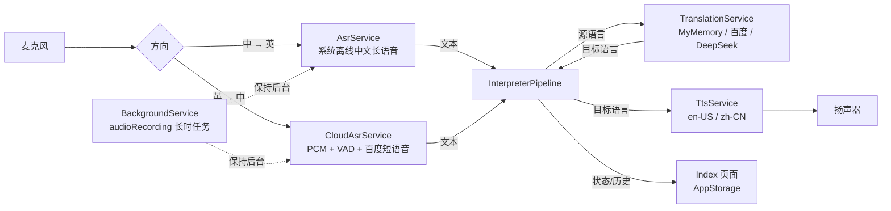

# 译耳同传 · 设计说明

## 1. 需求拆解

| 编号 | 需求 | 版本 | 实现 |
| --- | --- | --- | --- |
| 1 | 实时监听 | v1 | Core Speech Kit 离线长语音 + 自动续接 |
| 2 | 听到一句中文 → 转成英文读出来 | v1 | 中文 ASR → 云端翻译 → 英文 TTS |
| 3 | 不需要手动操作 | v1 | 启动即监听、自动重启、锁屏后台 |
| 4 | 英文 → 中文 | v0.2 已实现 | 自建 VAD + 百度短语音 + 反向翻译 + 中文 TTS（见 §8） |

产品形态：手机放在桌上 / 拿在手里，应用在前台或后台持续收音；说中文，几秒内听到英文。
核心体验指标：**一句结束到英文开口** ≤ 2.5s（网络正常、百度通道）。

## 2. 技术调研结论（基于本机 API 26 SDK 声明文件）

### 2.1 语音识别：Core Speech Kit（`@kit.CoreSpeechKit`）

- `speechRecognizer.createEngine({ language: 'zh-CN', online: 1, extraParams })`
  - 目前**仅支持中文、仅离线**（`@hms.ai.speechRecognizer.d.ts` 明确说明）。
  - `extraParams.recognizerMode` 支持 `short` / `long`，默认 `short`。
  - 长语音模式按句返回 `onResult`，`isFinal` 表示一句话结束，`isLast` 表示会话结束。
  - 单次 `writeAudio` 上限 60s；自动录音模式下会话也可能因静音/时长结束 → 应用侧必须能**无缝续接**。
- 结论：v1 采用 `long` 模式 + 自动重启会话，最贴合“实时监听一句话”的形态。

### 2.2 语音合成：`textToSpeech`（同 Kit）

- 支持 `zh-CN` 与 `en-US`；英文音色 `person = 8`（Laura，需要下载）。
- `createEngine` 的 `extraParams.isBackStage = true` 支持后台播放。
- 提供 `listVoices` / `downloadVoice` 查询与下载音色模型。
- 结论：英文朗读用系统离线 TTS，不依赖第三方，延迟低。

### 2.3 翻译：系统未开放端侧文本翻译 API

- 全量检索 API 26 SDK：只有 `AICaption`（AI 字幕组件）暴露 `sourceLanguage/targetLanguage`，
  但它是**自绘 UI 组件**，只提供 `onPrepared/onError`，不会把识别/译文文本回调给应用，
  因此无法拿译文去驱动 TTS。
- 其他 HMS 能力（`textProcessing`）只做分词/实体识别，不含翻译。
- 结论：翻译必须走云端。设计为**可插拔 `Translator` 接口**，内置三种实现：
  - `MyMemoryTranslator`：公共接口，零配置，用于试用；
  - `BaiduTranslator`：`fanyi-api.baidu.com`，MD5 签名，速度快；
  - `DeepSeekTranslator`：OpenAI 兼容 Chat Completions，译文更自然但延迟更高。

### 2.4 后台

- `backgroundTaskManager.startBackgroundRunning(context, BackgroundMode.AUDIO_RECORDING, wantAgent)`
  + `module.json5` 的 `abilities[].backgroundModes = ["audioRecording"]` + `KEEP_BACKGROUND_RUNNING` 权限。
- 失败时降级为“仅前台监听”，不阻塞主流程。

## 3. 总体架构



模块职责：

| 文件 | 职责 |
| --- | --- |
| `AsrEngine` | 识别引擎接口：start/stop/suspend/resume + 回调 |
| `AsrService` | 系统中文长语音：创建引擎、会话自动续接、错误退避 |
| `CloudAsrService` | 英文：AudioCapturer 采集、能量 VAD、百度短语音识别、token 缓存 |
| `Translator` | 翻译接口与三种实现、语言码映射、MD5、分段、缓存、降级 |
| `TtsService` | 中/英音色检查、下载、引擎重建、朗读 Promise 化、超时看门狗 |
| `InterpreterPipeline` | 方向选择、过滤、去重、翻译队列、朗读队列、历史与状态 |
| `SettingsService` | Preferences 读写（JSON）、字段归一化 |
| `BackgroundService` | 长时任务申请/释放，失败降级 |
| `Index.ets` | 权限、方向切换、启动/暂停、设置面板、双语字幕与历史 |

## 4. 关键流程

### 4.1 启动

```
页面 aboutToAppear
  → SettingsService.load
  → 申请 MICROPHONE（user_grant）
  → pipeline.start(context)
      → 按 direction 选择 AsrService 或 CloudAsrService
      → asr.start()（中→英先开麦；英→中先校验百度 token 再开麦）
      → TtsService.setLanguage(目标语言)（可能下载音色）
      → BackgroundService.start()（audioRecording）
  → 状态 listening
```

### 4.2 一句话的生命周期

```
ASR onResult(isFinal=true)
  → 过滤：必须包含 CJK；6 秒内相同文本去重
  → 生成 Utterance(state=translating)，写入历史，更新“最近一句”
  → translateQueue.push
  → pumpTranslate（串行）
       → TranslationService.translate（带缓存/重试）
       → state=done，更新历史与当前英文
       → speakQueue.push → pumpSpeak
  → pumpSpeak（串行，与翻译并行）
       → TtsService.speak(en)（Promise 等到播放完成）
```

**为什么要两条队列**：朗读通常 3–6 秒，而下一句翻译只需几百毫秒。翻译与朗读解耦后，
下一句的译文可以在上一句朗读期间就绪，整体延迟不累积。

### 4.3 自动续接状态机

```
          start()
            │
            ▼
      ┌──────────┐  onStart   ┌───────────┐
      │ starting │──────────▶│ listening │
      └──────────┘            └───────────┘
            ▲                   │  │  │
            │ onComplete/isLast │  │  │ onError
            │                   │  │  ▼
            │            stop() │  │ ┌──────────┐
            │                   │  └▶│ restart  │ 退避 500ms×n（≤4s）
            │                   ▼    └──────────┘
            │               ┌────────┐
            └───────────────│ paused │
                            └────────┘
```

- `onComplete`、`isLast`、`onError` 都会触发 `scheduleRestart`，用定时器去抖，避免重复会话。
- 旧会话的迟到回调通过 `sessionId` 比对丢弃。
- 连续错误 ≥3 次才在界面提示，避免偶发错误打扰。

### 4.4 自听回环

外放时麦克风会拾取英文朗读。中文离线 ASR 会把英文按谐音识别成中文（实测把 “I'm fine” 识别成 “我很好/我很”），
如果只做文本过滤，会形成“朗读 → 识别 → 翻译 → 朗读”的慢速回环。最终采用**播放期停麦**：

```
TTS onStart  → AsrService.suspend()：cancel 当前会话，不再重启
TTS onComplete → 1.2 秒后 AsrService.resume()：新建会话继续听
```

同时保留两道兜底：

1. `ttsQuietUntil`：播放结束后 1.5 秒内仍丢弃 final/partial；
2. 30 秒内相同句子只处理一次（去掉标点后比较），防止回声复现原句。

代价：英文播放期间用户说话会被丢掉。对“说一句 → 听一句”的同传节奏是可接受的；
若要做重叠说话，需要耳机或系统级 AEC，后续版本再处理。

### 4.5 实测踩坑与修正（Pura X / API 26）

第一版上真机后“完全识别不到讲话”，逐项排查后确认了四个关键点：

**① `recognitionMode` 默认是 1（外部写音频），不是 0（引擎自己录音）**

`StartParams.extraParams` 不传该字段时，引擎会等待应用调用 `writeAudio`，麦克风不会真正采集。
所以必须显式写：

```arkts
extraParams: {
  'recognitionMode': 0,        // 0 = 实时录音识别
  'maxAudioDuration': 28800000 // 8 小时
}
```

**② 长语音的 `maxAudioDuration` 默认只有 20 秒**

不设置时，系统在 20 秒后悄悄结束会话（日志里 `maxAudioDuration: 20000`）。
长语音范围为 20000 ~ 28800000 ms，必须显式设置。

**③ 空闲 `vadBegin` 默认 10 秒，会话会结束**

日志里 `vadBegin: 10000`，无人说话约 10 秒后 `onComplete`。本项目把它调到 60 秒，
同时保留 `onComplete → 自动重启` 的兜底，因此静音再久也能继续听。

**④ 百度翻译只认 `zh` / `en`，不认 `zh-CN` / `en-US`**

最初直接把 BCP-47 语言码传给百度，接口返回 `54003 Invalid Access Limit`（看起来像限流，
实际是参数不被接受）。修正为按服务商映射语言码，并加入 1.15 秒节流（免费版 QPS = 1）
和一次 `54003/54005` 重试。

其他实测结论：

- 百度单次请求正常，`q/from/to/appid/salt/sign` 与 `MD5(appid+q+salt+key)` 一致。
- 英文朗读 `person = 8` 在真机可用，`listVoices` 显示 `already downloaded`。
- 回声过滤：外放时中文 ASR 会把英文朗读识别成中文（实测把整段英文识别成中文谐音，
  再把“我很好”翻译回 “I'm fine”）。最终改为 **TTS 播放期间 `AsrService.suspend()` 停麦，
  播放结束 1.2 秒后 `resume()`**；并加 1.5 秒静默期与 30 秒同句去重。

## 5. 失败处理

| 场景 | 行为 |
| --- | --- |
| 麦克风被拒 | 页面显示授权卡片，不自动开始 |
| ASR 初始化失败 | 状态 error，错误条提示，可再次点开始 |
| ASR 会话异常结束 | 自动退避重连，界面保持监听态 |
| 翻译网络失败 | 单句标记失败并重试一次；流水线继续处理后续句子 |
| 翻译服务未配置 | 自动降级到免注册通道（`createTranslator`） |
| 英文音色未下载 | 启动时自动下载；失败则错误条提示，重试入口在设置 |
| TTS 卡死 | 看门狗 15–60s 超时，释放队列继续 |
| 后台任务被拒 | 仅前台监听，功能不受影响 |

## 6. 权限与隐私

- `ohos.permission.MICROPHONE`（user_grant）：实时收音。
- `ohos.permission.INTERNET`：调用翻译接口 / 百度短语音。
- `ohos.permission.KEEP_BACKGROUND_RUNNING`：锁屏持续监听。
- 中→英：原始音频只在设备内交给系统离线识别，不上传；识别文本发送给所选翻译服务。
- 英→中：英文音频会发送到百度短语音识别，识别文本再发送给翻译服务。
- 设置与历史保存在应用私有 Preferences 中；百度密钥仅本机保存。

## 7. 兼容性

- `compatibleSdkVersion 5.0.0(12)`，`targetSdkVersion 26.0.0`。
- 使用的 Core Speech Kit 能力自 API 11/12 起提供；`Circle.fill` 等 UI 属性在旧版本上会降级，
  不影响核心功能。
- 若需覆盖 HarmonyOS 5 设备，建议在启动时用 `canIUse` 守护 `AICaption` 等新 API（本项目未使用）。

## 8. 英文 → 中文（v2）实现

### 8.1 为什么必须用云端

实测 API 26 的系统识别只支持中文：

```
EN_ASR_FAIL lang=en-US code=1002200001 msg=Asr CreateEngineParams is wrong!
EN_ASR_FAIL lang=en-GB code=1002200001 ...
EN_ASR_OK   lang=zh-CN
EN_ASR_LANGS ["zh-CN"]
```

`AICaption` 组件支持英文识别 + 翻译，但只提供显示，不回调文本，无法驱动 TTS。
端侧 Whisper/Vosk 需要额外 native 库与 40MB+ 模型，首版不采用。

### 8.2 采用方案：自建 VAD + 百度短语音识别

```
AudioCapturer(16k/16bit/mono, 100ms 帧)
  → 能量 VAD：噪声底自适应，连续 800ms 静音断句，最长 20s
  → 原始 PCM Base64
  → POST https://vop.baidu.com/server_api
       { format:'pcm', rate:16000, channel:1, dev_pid:1737,
         token, cuid, len, speech }
  → result[0] 英文文本
  → Translator(en→zh) → TtsService(zh-CN, person 13)
```

关键点：

- **token**：`https://aip.baidubce.com/oauth/2.0/token`（API Key + Secret Key），缓存到过期前。
- **dev_pid = 1737**：百度英文模型；中文是 1537，粤语 1637。
- **句级上传**：短语音接口单次 ≤60s，这里 20s 上限，通常 2–5s 音频即上传。
- **VAD**：噪声底 `noiseFloor = 0.95*noiseFloor + 0.05*rms`，阈值 `max(300, noiseFloor*2.2+100)`；
  说话前保留 400ms 预录，避免吞字。
- **并发**：采集与识别解耦；识别队列串行，避免百度 QPS 限制。
- **失败**：token/识别失败会通过错误条提示；不会静默丢句。

### 8.3 方向切换

`Direction = 'zh-en' | 'en-zh'` 存在设置里，`InterpreterPipeline` 据此：

```
buildAsr(): zh-en → AsrService；en-zh → CloudAsrService
 Translator.translate(source, zh-CN→en-US | en-US→zh-CN)
 TtsService.setLanguage(en-US | zh-CN)
```

界面顶部两个 chip 直接切换；运行中切换会重启流水线，翻译/朗读队列清空，历史保留。
`Utterance` 记录 `direction`，历史按“源文本 → 译文”展示。

### 8.4 延迟预算（英→中，实测目标）

| 阶段 | 预估 |
| --- | --- |
| 静音断句 | 0.8s |
| PCM 上传 + 百度识别 | 0.6–1.5s |
| 翻译 | 0.2–0.5s |
| 中文 TTS 开口 | 0.3s |
| **合计（句末到开口）** | **约 2–3s** |

比中→英多约 1s，属于“句级同传”可接受范围。后续换 WebSocket 流式识别可压到 1.5s 内。

### 8.5 备选与后续

| 方案 | 状态 |
| --- | --- |
| 百度实时语音识别 WebSocket | v0.3 计划，降低延迟 |
| Azure / 腾讯云 / 火山引擎 ASR | 可插拔扩展，需新增 provider |
| 端侧 Whisper / Vosk | 离线、隐私好，但包体大、集成成本高 |
| 系统 AICaption | 只能显示，拿不到文本，不采用 |

## 9. 后续优化

- 延迟埋点：记录 `final→译文→开口` 时间，显示在设置页。
- 翻译上下文：把上一句作为 `context` 传给 DeepSeek，改善指代与术语一致性。
- 热词：`sysGeneralLexicon` 注入人名/地名/专业词，提高识别率。
- 悬浮字幕：使用 `window` 悬浮窗或系统画中画，支持全屏会议场景。
- 端侧翻译：接入 MindSpore Lite + 小型翻译模型，离线可用。
